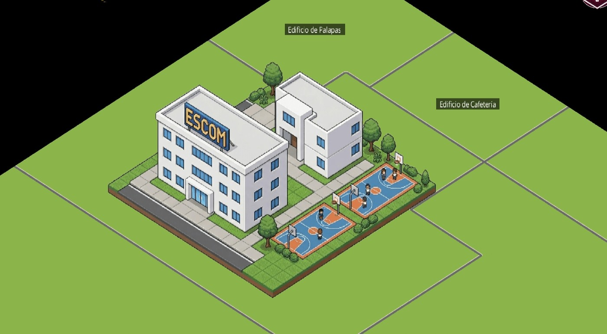
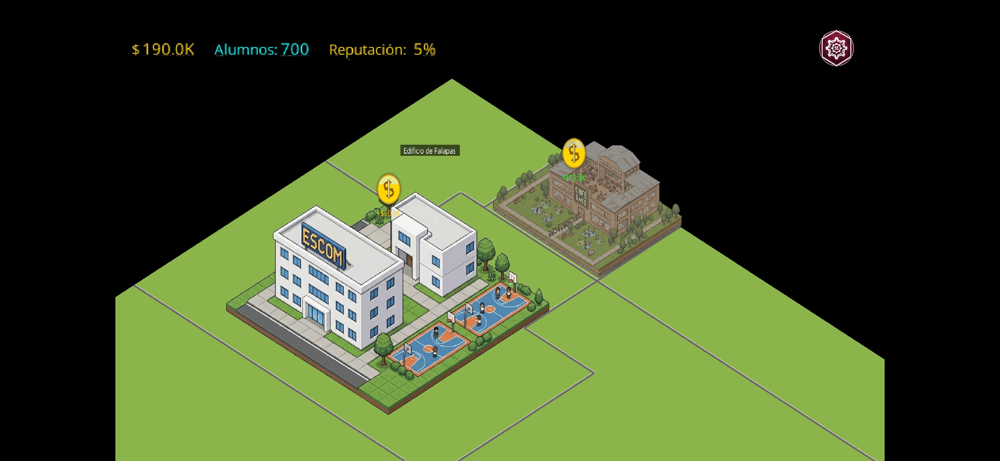
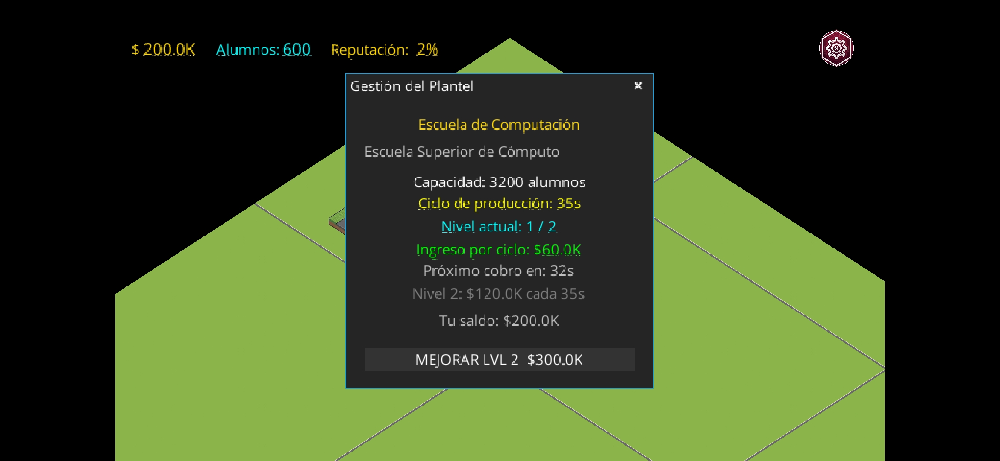
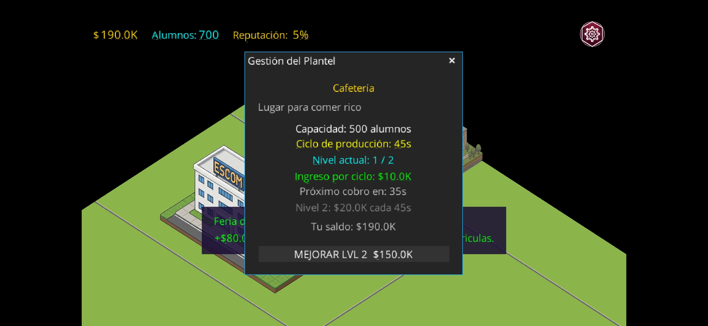
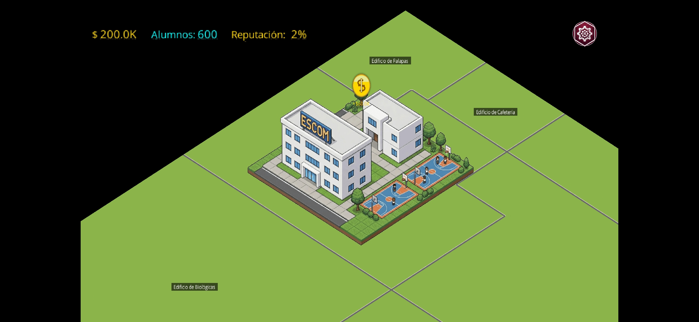
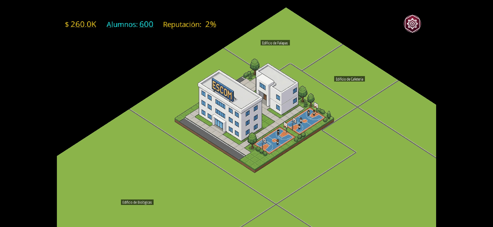

# Matriz de Pruebas de QA - Entrega 2

## Proyecto: EduTycoon - Gestión e Infraestructura Politécnica
**Institución:** Instituto Politécnico Nacional (IPN)  
**Unidad Académica:** Escuela Superior de Cómputo (ESCOM)  
**Asignatura:** Desarrollo de aplicaciones móviles nativas (2027-1)  
**Característica:** Sistema interactivo de recolección de ingresos por edificio (Tycoon) y actualización en Google Play  
**Rama:** `feature/interactive-building-income`  
**Versiones evaluadas:**  
- **Línea Base (Primer Lanzamiento Play Store):** Versión `1.0.0` (versionCode `1`)
- **Actualización Publicada (Segundo Lanzamiento Play Store):** Versión `1.1.0` (versionCode `2`)

---

## 📋 Resumen Ejecutivo de Pruebas
Esta matriz documenta la validación integral conforme a las especificaciones oficiales de la **Entrega 2**. Se evalúa el ciclo de vida de distribución en canal de **Prueba Cerrada de Google Play Console**, la preservación de datos ante actualización OTA (sin desinstalar) y la implementación de la nueva mecánica Tycoon: **generación de burbujas flotantes interactivas por ciclo de edificio, recolección manual táctil, retroalimentación auditiva y visual de ganancias**.

* **Dispositivo de prueba 1:** Google Pixel 7 (Emulador Android Studio - API 34).
* **Dispositivo de prueba 2:** Dispositivo físico Android (API 34 / Android 14).
* **Herramienta de pruebas automatizadas:** JUnit 4 / Gradle (`./gradlew :core:test`).
* **Verificación de construcción móvil:** Gradle (`./gradlew assembleDebug`).

---

## 🧪 Matriz de los 6 Casos de Prueba Oficiales (Entrega 2)

| ID | Caso de Prueba | Categoría / Requisito PDF | Pasos de Ejecución | Resultado Esperado | Resultado Observado | Estado |
| :--- | :--- | :--- | :--- | :--- | :--- | :--- |
| **CP-E2-01** | Instalación inicial desde Google Play y arranque de partida | Instalación Inicial por Google Play (Ruta Feliz) | 1. Ingresar con cuenta de tester al enlace de prueba cerrada en Google Play Store.<br>2. Instalar la versión inicial `1.0.0` (versionCode `1`).<br>3. Abrir la aplicación y crear una nueva partida ingresando nombre y escuela en el tutorial. | La aplicación descarga, instala y abre sin cierres forzados. El tutorial del Ing. Cárdenas se ejecuta correctamente y el mapa isométrico se carga con el presupuesto inicial ($500,000 MXN). | Descarga correcta vía Google Play, ejecución fluida y juego listo para gestión. | ✅ APROBADO |
| **CP-E2-02** | Generación de burbuja flotante y recaudación manual táctil con audio y animación | Funcionamiento de la Mejora (Tarea Principal Tycoon) | 1. En la partida, adquirir el plantel "Mac and Cheese" o "Cafetería".<br>2. Aguardar el cumplimiento del ciclo de producción (45s - 50s).<br>3. Observar la aparición de la burbuja interactiva dorada sobre el edificio.<br>4. Tocar la burbuja para recolectar el dinero. | Aparece la burbuja flotante con animación oscilatoria (*bobbing*) y la etiqueta `+$X`. Al pulsarla, se reproduce el efecto de sonido de caja registradora (`coin.wav`), se despliega la animación flotante con desvanecimiento de saldo acreditado y el saldo del HUD en la esquina superior izquierda se incrementa de inmediato. | Burbuja generada en techo del edificio, efecto sonoro limpio, animación de texto `+$X` ascendente y saldo actualizado. | ✅ APROBADO |
| **CP-E2-03** | Variabilidad de tiempos de producción y bloqueo de cobro anticipado | Entrada / Caso Límite y Regla de Negocio | 1. Poseer dos edificios: uno inicial ("Mac and Cheese", ciclo de 50s) y uno avanzado ("Auditorio", ciclo de 25s).<br>2. Abrir la ventana de gestión del edificio antes de que termine el ciclo.<br>3. Intentar cobrar antes de tiempo tocando el edificio. | La ventana de información muestra con precisión el tiempo de ciclo configurado y los segundos restantes. El sistema no genera ingresos antes de tiempo ni permite cobros prematuros (`recolectar()` devuelve 0L). Los edificios avanzados completan sus ciclos significativamente más rápido que los iniciales. | Tiempos independientes verificados, cobro bloqueado mientras la producción está en curso y ventana informativa veraz. | ✅ APROBADO |
| **CP-E2-04** | Actualización de versión vía Play Store sin desinstalar | Instalación de Actualización (Google Play) | 1. Con la versión `1.0.0` instalada y con progreso guardado (edificios comprados y saldo acumulado), ingresar a Google Play Store.<br>2. Seleccionar "Actualizar" a la versión `1.1.0` (versionCode `2`).<br>3. Abrir la app tras completarse la descarga sin borrar datos. | La aplicación se actualiza correctamente conservando los datos de sesión previa (`GameState` / Room / SharedPreferences). El nuevo motor de recaudación interactiva queda activo en la partida existente sin inconsistencias. | Actualización completada sin desinstalación previa; versión 1.1.0 activa con datos persistidos intactos. | ✅ APROBADO |
| **CP-E2-05** | Accesibilidad visual, contraste WCAG y retroalimentación táctil | Accesibilidad y Usabilidad | 1. Configurar texto grande (130%) en los ajustes del sistema operativo.<br>2. Activar modo silenciado desde el menú de pausa y observar las burbujas en el mapa.<br>3. Verificar área de toque táctil de las burbujas y contraste del texto dorado/verde sobre el mapa. | La burbuja de recaudación posee un área táctil mínima generosa (>48dp en espacio de pantalla), contraste nítido y legible contra cualquier fondo de terreno, y provee retroalimentación visual inmediata aunque el audio esté silenciado. | Alta legibilidad visual, fácil pulsación con una sola mano y contraste conforme a WCAG 2.1 AA. | ✅ APROBADO |
| **CP-E2-06** | Preservación de temporizadores ante pausa, suspensión y minimizado | Ciclo de Vida y Persistencia de Estado | 1. Dejar un edificio en producción al 50% de su ciclo.<br>2. Presionar el botón Home para minimizar la app a segundo plano.<br>3. Abrir otras aplicaciones y regresar a EduTycoon tras varios minutos. | La aplicación recupera el foco sin fallas de memoria (OOM), el temporizador de producción avanza correctamente de acuerdo al tiempo transcurrido o retoma la ejecución, activando la burbuja si el ciclo culminó en segundo plano. | Sin fallas ni desincronización de texturas en libGDX tras retorno de segundo plano. | ✅ APROBADO |

---

## 🤖 Cobertura de Pruebas Unitarias Automatizadas (CI Local)

Se crearon y validaron pruebas automatizadas en `io.moviles.IPN_Tycoon.engine.BuildingIncomeManagerTest` y `io.moviles.IPN_Tycoon.engine.AudioManagerTest`:

* `ciclo no avanza para propiedades no compradas`: Garantiza que edificios sin adquirir no consuman ni generen ingresos.
* `ciclo acumula tiempo y marca listo para recolectar al completarse`: Valida la transición temporal y el cálculo aritmético exacto del ingreso.
* `recolectar acredita saldo en GameState y reinicia ciclo`: Valida la acreditación atómica en `GameState.dinero` y el reseteo del temporizador.
* `edificios iniciales tienen ciclos mas lentos que edificios avanzados`: Verifica la curva de progresión y ritmo económico entre planteles baratos vs. caros.
* `recolectar sin ingresos listos devuelve cero y no altera saldo`: Previene condiciones de carrera o sobregiros de recaudación.
* `recolectarTodo procesa todos los edificios con ciclo completado`: Asegura el funcionamiento masivo de recolección en todo el campus.
* `reproducirSonidoDinero maneja entornos headless sin fallos`: Garantiza la robustez de audio en servidores de integración continua sin tarjeta de sonido.

**Resultado de ejecución:**
```text
Gradle Test Run :core:test
Tests completed: 100% successful, 0 failures, 0 skipped.
BUILD SUCCESSFUL
```

---

## 📸 Evidencias Visuales de Implementación y QA

### 1. Comparativa Antes vs. Después (CP-E2-02)

| Antes: Sin Burbujas (Generación Pasiva) | Después: Burbujas Interactivas (Recaudación Táctil) |
| :---: | :---: |
| <br><sub>**Antes:** Generación pasiva e incierta sin avisos visuales ni sonoros.</sub> | <br><sub>**Después:** Burbujas doradas flotantes sobre los edificios con ciclo concluido.</sub> |

### 2. Transparencia y Tiempos de Ciclo en Ficha de Gestión (CP-E2-03)

| Definición de Tiempo por Ciclo | Tiempo de Ciclo de Ingresos Añadido |
| :---: | :---: |
| <br><sub>Estadísticas de plantel y duración del ciclo de producción (ej. 35s).</sub> | <br><sub>Desglose de ingresos por ciclo y alerta de fondos listos para cobrar.</sub> |

### 3. Notificación Emergente, Animación y Acreditación de Saldo (CP-E2-02, CP-E2-05)

| Burbuja Emergente sobre Plantel | Animación Ascendente de Recaudación | Saldo Acreditado en el HUD |
| :---: | :---: | :---: |
| <br><sub>Burbuja dorada emergente sobre el edificio.</sub> | <br><sub>Animación flotante del monto (`+$X`) con sonido `coin.wav`.</sub> | <br><sub>Saldo del presupuesto incrementado al instante.</sub> |
